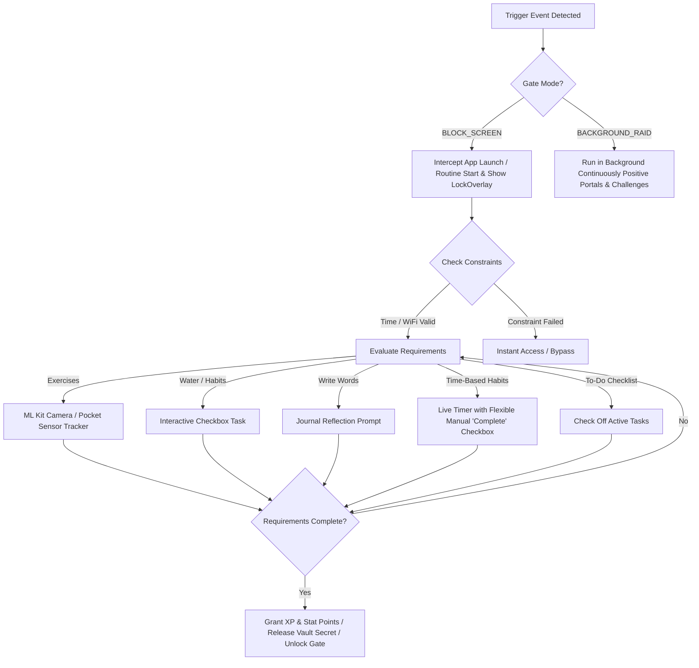
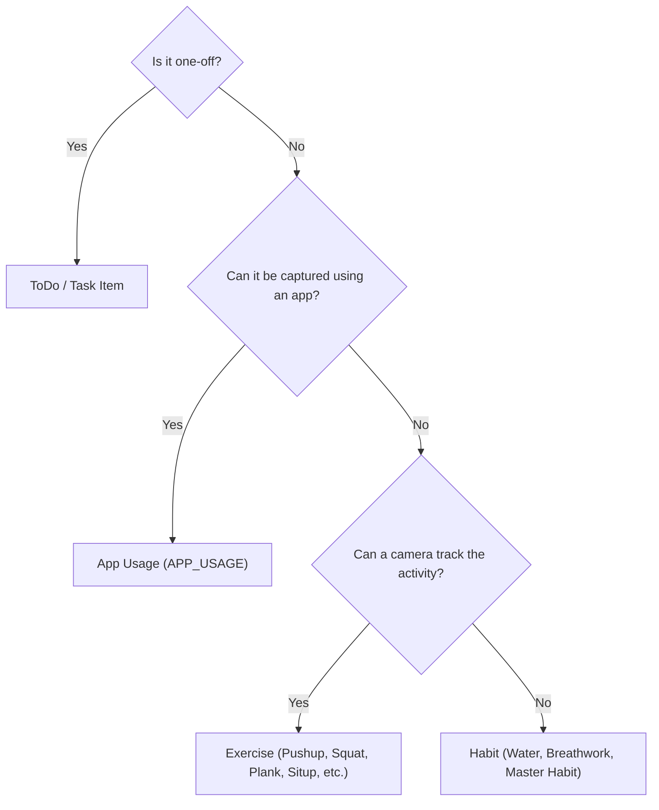

# Unified Protocol Gate Architecture & Decision Flowchart

> [!NOTE]
> This document details the refined `ProtocolGate` architecture, mapping App Blocks, Positive Focus Portals, Routines, and Challenges into a single cohesive system where **To-Do, App Usage, Exercise, and Habits** form the core requirements.

---

## 1. Unified Protocol Architecture Table (Refined)

| Feature / System | Gate Mode (`GateMode`) | Primary Triggers | Constraints | Requirements | Rewards / Outcomes |
| :--- | :--- | :--- | :--- | :--- | :--- |
| **🔒 Restrictive App Blocks** | `BLOCK_SCREEN` | `APP` (Package Names) | Time Range, WiFi SSID | Exercises, Water, Writing, Breathwork, To-Dos, Habit Quests | Unlocks target app for N minutes |
| **☀️ Routines / Habit Stacks** | `BLOCK_SCREEN` | `TIME`, `WIFI`, `MANUAL` | Time Range, WiFi SSID | Sequence of habits, breathwork, and exercises | Blocks screen until routine steps are completed, grants XP |
| **🟢 Positive Focus Portals** | `BACKGROUND_RAID` | `APP` (Package Names) | Time Range | Productive App Usage | Tracks usage passively in background, grants +XP / min & Attribute growth |
| **⚔️ Challenges & Raids** | `BACKGROUND_RAID` | `MANUAL` | None | Cumulative exercise reps or habit completions | Elite badges, XP rewards, Hall of Trophies unlock |
| **💎 Secret Vault** | `BLOCK_SCREEN` | `MANUAL` / `APP` | None | Specific exercise or cognitive toll | Releases secret password, vault note, or private link |

---

## 2. Protocol Gate Execution Flowchart

---

## 3. Action Classification Flowchart (User Decision Tree)

